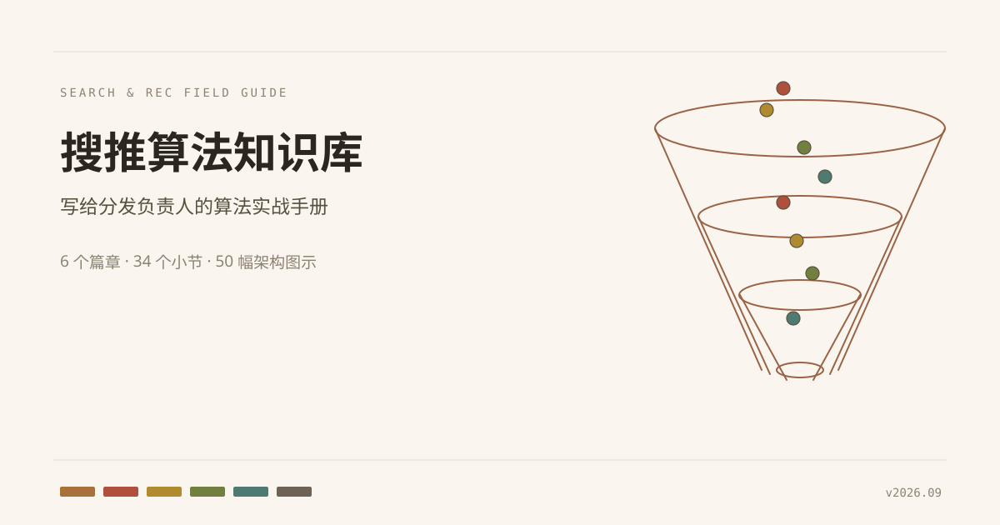

# Search & Rec Field Guide

**搜推算法知识库**：写给正在向分发负责人进阶的策略产品经理，一本文图并茂的搜索与推荐算法实战手册。

[](https://github.com/koopawu/search-rec-field-guide/actions/workflows/ci.yml)
[](LICENSE)



## 项目简介

本项目是一个内容密集型中文在线知识库，系统整理搜索引擎、推荐系统、流量分发策略、评估实验、LLM 前沿及工程协作知识。内容强调三个问题：**算法是什么、解决什么问题、策略产品如何应用**。

- 6 个篇章，34 个小节
- 50 幅由 React + SVG 绘制的架构图示
- 大厂实践案例及来源引用
- 首页知识地图与 7 天学习路径
- 全站客户端搜索与 `⌘K` / `Ctrl+K` 命令面板
- 阅读进度、学习打卡和最近搜索记录

## 内容目录

| 篇章 | 小节数 | 主要主题 |
| --- | ---: | --- |
| 搜索引擎篇 | 6 | Query 理解、文本/向量召回、LTR、双塔、BERT、相关性融合 |
| 推荐系统篇 | 7 | 多路召回、双塔、序列建模、精排、多目标、粗排与重排 |
| 分发策略实战篇 | 6 | 冷启动、Bandit、多样性、流量调控、商业化混排、平台机制 |
| 评估与实验篇 | 5 | 指标体系、离线评估、A/B 实验、长期实验、归因与数据陷阱 |
| LLM 时代前沿篇 | 5 | 混合检索、RAG、Deep Research、生成式推荐、搜推问一体化 |
| 工程架构与协作篇 | 5 | 三层架构、延迟预算、索引、模型更新、评审与团队协作 |

## 技术栈

- React 19 + TypeScript
- Vite 7
- Tailwind CSS 3 + shadcn/ui
- React Router
- Framer Motion + GSAP
- Lenis

## 本地运行

要求：Node.js 20+，npm 10+。

```bash
# 安装依赖
npm ci

# 启动开发服务器（默认端口 3000）
npm run dev

# 类型检查并构建生产版本
npm run build

# 预览构建产物
npm run preview

# 可选：运行 ESLint
npm run lint
```

生产文件输出到 `dist/`。项目为纯前端单页应用，部署时需要将未知路径回退到 `index.html`，以支持直接访问章节路由。

## 项目结构

```text
.
├── public/                     # 静态资源
├── src/
│   ├── components/
│   │   ├── atoms/              # 标签、徽标、进度条等基础组件
│   │   ├── blocks/             # 9 种内容块渲染器
│   │   ├── diagrams/           # SVG 图示注册表与 50 幅图示
│   │   ├── home/               # 首页知识地图与学习路径
│   │   ├── reading/            # 阅读页目录、导航与打卡
│   │   └── ui/                 # shadcn/ui 组件
│   ├── content/
│   │   ├── chapters/           # 6 个篇章的结构化中文内容
│   │   ├── index.ts            # 内容查询与聚合
│   │   ├── site.ts             # 站点信息和学习路径
│   │   └── types.ts            # 内容 Schema
│   ├── lib/search/             # 客户端搜索索引、检索与高亮
│   └── pages/                  # 首页、篇章页、阅读页、图示库、搜索页
├── .github/workflows/ci.yml    # GitHub Actions 构建检查
└── vite.config.ts
```

## 内容维护

篇章内容使用 TypeScript 结构化维护，支持段落、要点、表格、步骤、公式、图示、案例、引用和列表 9 种内容块。新增内容时：

1. 在 `src/content/chapters/` 中编辑对应篇章。
2. 按 `src/content/types.ts` 中的 Schema 添加小节或内容块。
3. 如需新图示，在 `src/components/diagrams/figures/` 添加组件并注册。
4. 执行 `npm run build`，确认类型检查和生产构建通过。

案例数据应尽量保留来源、时间及统计口径；公司自报数据与行业二手解读需要明确区分。

## 数据与隐私

本项目无后端、无账号体系，也不收集用户数据。阅读打卡和最近搜索仅存储在当前浏览器的 `localStorage` 中，不会跨设备同步；清除浏览器数据会删除这些记录。

## License

[MIT](LICENSE) © 2026 koopawu
